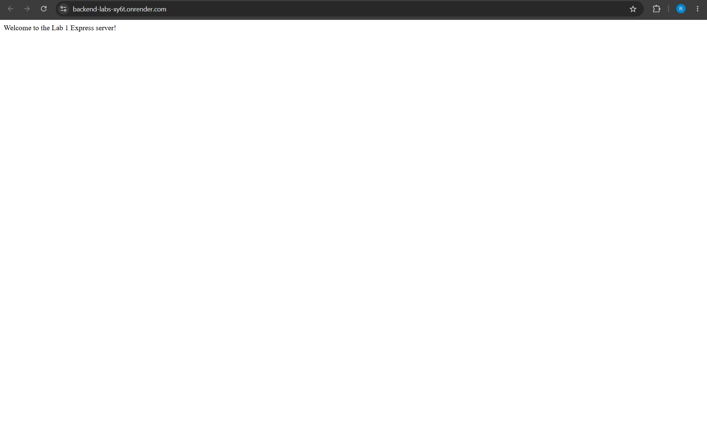
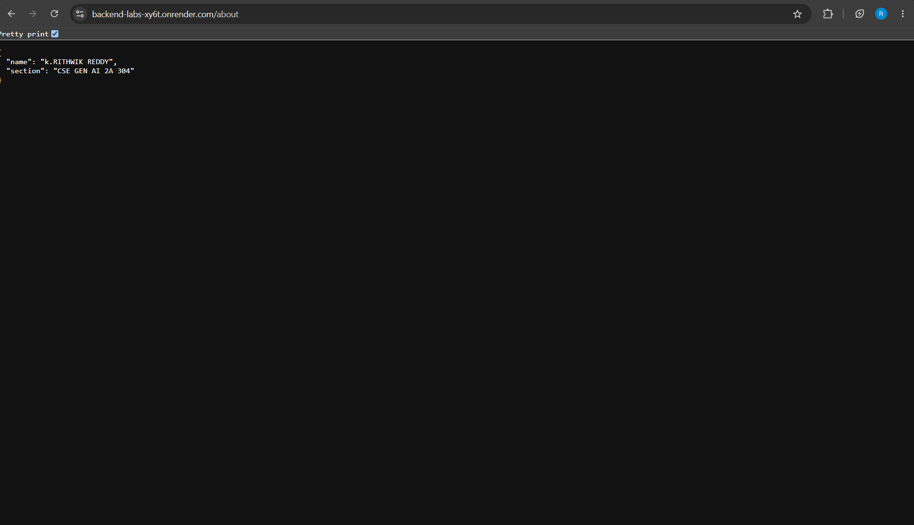
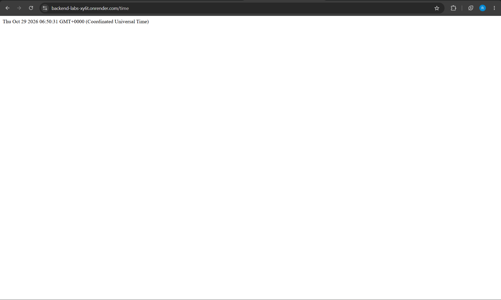
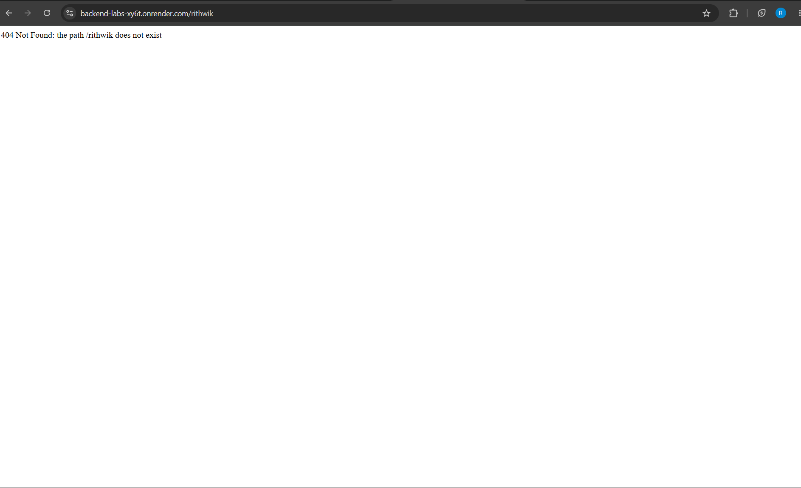

# Lab 1: Node.js and Express Server

## Student Details

* **Name:** K. Rithwik Reddy
* **Registration Number:** 252U1R9059
* **Section:** CSE GEN AI 2A 304
* **Subject:** Backend Development Fundamentals

## Live Link

**Deployment Status:** Not deployed yet.

Once the application is deployed, add the public URL here.

## Objective

To set up a Node.js project and build a web server using the built-in HTTP module and Express.js. The server handles different routes, returns appropriate responses, displays the current date and time, and responds with a 404 status code for unknown paths.

## Technologies Used

* **Node.js:** JavaScript runtime used to run JavaScript outside the browser.
* **Express.js:** Web framework used to create the server and handle HTTP routes.
* **npm:** Package manager used to install dependencies and run project scripts.
* **JavaScript:** Programming language used to implement the server.

## Project Structure

```text
lab-01/
├── server.js
├── server-http.js
├── package.json
├── package-lock.json
├── .gitignore
├── README.md
└── screenshots/
    ├── home.png
    ├── about.png
    ├── time.png
    └── not-found.png
```

## How to Run

### Prerequisites

Make sure Node.js and npm are installed on your computer.

Check their versions using:

```bash
node --version
npm --version
```

### Step 1: Install Dependencies

Open the terminal inside the `lab-01` directory and run:

```bash
npm install
```

This command installs the dependencies listed in `package.json`, including Express.js.

### Step 2: Start the Express Server

Run:

```bash
npm start
```

The server starts on port 3000 by default.

Expected terminal output:

```text
Server running at http://localhost:3000
```

### Step 3: Start the Plain Node.js HTTP Server

Stop the Express server using `Ctrl + C`.

Then run:

```bash
npm run start:http
```

This starts the plain Node.js HTTP server on port 3000.

**Note:** Both servers use port 3000, so they cannot run simultaneously on the same port. Stop one server before starting the other.

## Environment Variables

No environment variables are required.

The server uses port `3000` by default. If the application supports a configurable `PORT` environment variable, you can set it before starting the server.

Do not commit or upload a `.env` file containing secrets.

## Endpoints

The Express server provides the following endpoints:

| HTTP Method | Endpoint   | Description                                                   | Expected Status Code |
| ----------- | ---------- | ------------------------------------------------------------- | -------------------- |
| GET         | `/`        | Returns a welcome message.                                    | 200 OK               |
| GET         | `/about`   | Returns JSON containing the student's name and section.       | 200 OK               |
| GET         | `/time`    | Returns the current date and time using `new Date()`.         | 200 OK               |
| GET         | `/unknown` | Returns a 404 error message because the route does not exist. | 404 Not Found        |

The `/unknown` endpoint is an example of an unknown path. Any unmatched path should return a 404 response.

## Testing the Endpoints

Start the Express server:

```bash
npm start
```

Open the following addresses in your browser.

### 1. Home Route

**URL:** `http://localhost:3000/`

**Expected Output:**

```text
Welcome to my Node.js and Express server!
```

**Status Code:** `200 OK`

### 2. About Route

**URL:** `http://localhost:3000/about`

**Expected Output:**

```json
{
  "name": "K. Rithwik Reddy",
  "section": "CSE GEN AI 2A 304"
}
```

**Status Code:** `200 OK`

The actual output depends on the name and section configured in `server.js`.

### 3. Time Route

**URL:** `http://localhost:3000/time`

**Expected Output:**

```json
{
  "currentDateTime": "2026-10-29T05:45:00.000Z"
}
```

**Status Code:** `200 OK`

The date and time shown above are examples. The actual response is generated dynamically using `new Date()`.

### 4. Unknown Route

**URL:** `http://localhost:3000/unknown`

**Expected Output:**

```text
404 - Page Not Found
```

**Status Code:** `404 Not Found`

The response depends on the 404 handler configured in `server.js`.

## Status Codes Verification

| Route      | Expected Status Code | Meaning                            |
| ---------- | -------------------- | ---------------------------------- |
| `/`        | 200                  | The request was successful.        |
| `/about`   | 200                  | The request was successful.        |
| `/time`    | 200                  | The request was successful.        |
| `/unknown` | 404                  | The requested route was not found. |

To verify the status codes:

1. Start the server using `npm start`.
2. Open the browser.
3. Press `F12` to open Developer Tools.
4. Select the **Network** tab.
5. Visit each endpoint.
6. Click the corresponding request.
7. Check the HTTP status code.

## Screenshots

The screenshots are stored in the `screenshots/` directory.

**Click any link below to open the corresponding screenshot.**

### 1. Home Route

[Open Home Route Screenshot](screenshots/home.png)



### 2. About Route

[Open About Route Screenshot](screenshots/about.png)



### 3. Time Route

[Open Time Route Screenshot](screenshots/time.png)



### 4. 404 Error Route

[Open 404 Error Screenshot](screenshots/not-found.png)



**Important:** Save the actual screenshots using these exact filenames inside the `screenshots/` folder. GitHub will display the images when the files exist at the specified paths.

## Explanation of package.json Fields

### 1. name

Specifies the name of the project package.

### 2. version

Specifies the current version of the project.

### 3. description

Provides a short description of the project.

### 4. main

Specifies the main entry file for the package.

### 5. scripts

Defines commands that can be executed using npm.

For example:

```json
"scripts": {
  "start": "node server.js",
  "start:http": "node server-http.js"
}
```

The `npm start` command runs the Express server, while `npm run start:http` runs the plain HTTP server.

### 6. keywords

Contains search terms associated with the package.

### 7. author

Specifies the name of the package author.

### 8. license

Specifies the license under which the project is distributed.

### 9. dependencies

Lists packages required by the application at runtime, such as Express.js.

## Viva Questions and Answers

### 1. What is Node.js?

Node.js is a JavaScript runtime that allows JavaScript to run outside a web browser.

### 2. What is Express.js?

Express.js is a web framework for Node.js that simplifies server creation and route handling.

### 3. What is npm?

npm stands for Node Package Manager. It is used to install and manage JavaScript packages.

### 4. What is the difference between package.json and node_modules?

`package.json` stores project information, scripts, and dependency details. `node_modules` contains the installed packages.

### 5. What does app.listen() do?

`app.listen()` starts the Express server on a specified port and allows it to accept incoming HTTP requests.

### 6. What are request and response?

* **Request (`req`):** Represents the incoming HTTP request and contains information such as the URL, method, and headers.
* **Response (`res`):** Is used to send the server's response to the client.

### 7. What is a route?

A route defines how a server responds to a particular URL and HTTP method.

### 8. What is the purpose of the GET method?

The GET method is used to request data from a server.

### 9. What is a status code?

An HTTP status code indicates the result of an HTTP request.

### 10. What does status code 200 mean?

Status code 200 means the request was successful.

### 11. What does status code 404 mean?

Status code 404 means the requested resource or route was not found.

### 12. What is JSON?

JSON stands for JavaScript Object Notation. It is a text format used to exchange structured data.

### 13. What does res.json() do?

`res.json()` sends a JSON response to the client and sets the appropriate content type.

### 14. What does new Date() do?

`new Date()` creates a JavaScript Date object representing the current date and time.

### 15. What is a port?

A port is a communication endpoint used by applications to receive network connections. This project uses port 3000 by default.

### 16. What is the difference between Node.js HTTP and Express.js?

The built-in HTTP module allows us to create a server directly. Express.js provides additional features that simplify route handling and request processing.

### 17. Why do we use node_modules?

The `node_modules` directory stores the packages installed for a Node.js project.

### 18. Why should node_modules not be uploaded to GitHub?

It can be recreated by running `npm install`, so committing it is generally unnecessary and makes the repository larger.

### 19. What is app.get()?

`app.get()` defines a route that handles HTTP GET requests for a specified path.

### 20. What happens when an unknown route is requested?

The server returns a 404 status code and an appropriate error message.

## Problems Faced and Solutions

Add details about the problems you actually encountered while developing and testing this project.

Example topics you may discuss if they occurred:

* Installing Express.js.
* Starting the server on port 3000.
* Correcting route paths.
* Testing responses and status codes.
* Fixing incorrect screenshot paths.

Describe only the problems you actually faced and how you solved them.

## Git and GitHub Submission

Before submitting the project, make sure that:

* The `lab-01` folder is present in your course repository.
* The `README.md` file is included.
* The `screenshots/` directory contains all four screenshots.
* The `.gitignore` file excludes `node_modules/` and `.env`.
* The project code is committed and pushed to GitHub.
* The repository is public or shared with your faculty.

Example `.gitignore`:

```text
node_modules/
.env
```

Example Git commands, run from the course repository root:

```bash
git add lab-01/
git commit -m "Complete Lab 1 Node.js and Express server"
git push
```

## Result

The Node.js project was set up, and the server was implemented using the built-in HTTP module and Express.js. The Express server provides a welcome route, an about route returning JSON, a route displaying the current date and time, and a 404 handler for unknown paths.

Verify that all endpoints work correctly and capture the required screenshots before submitting the lab.
