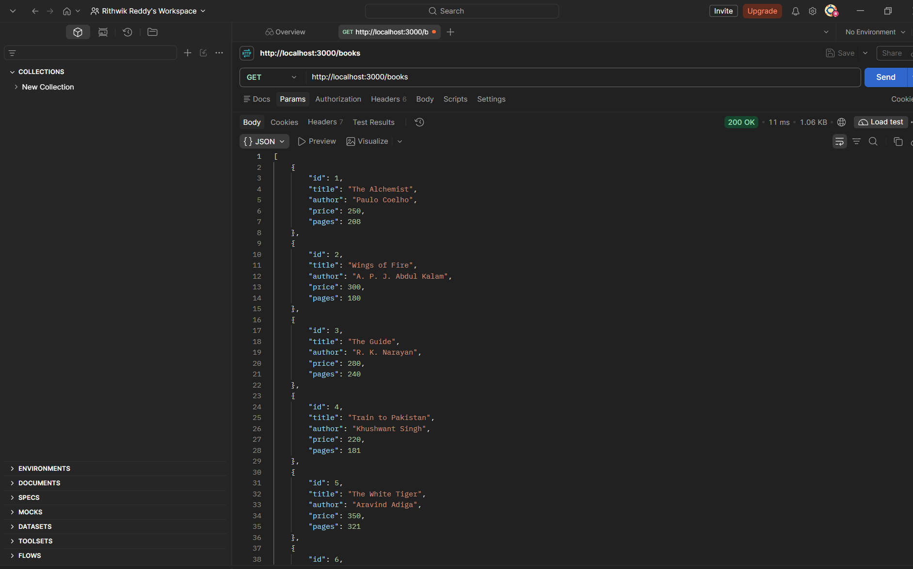
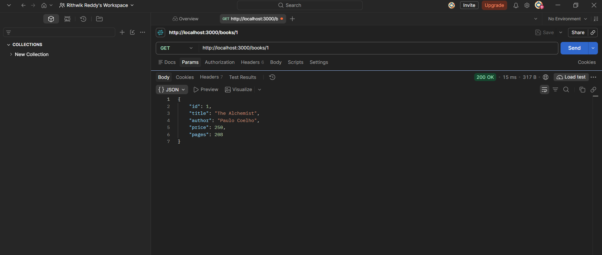
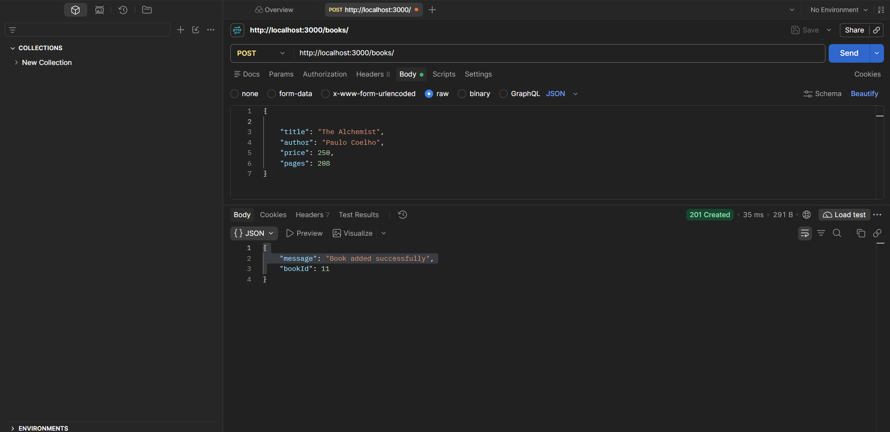
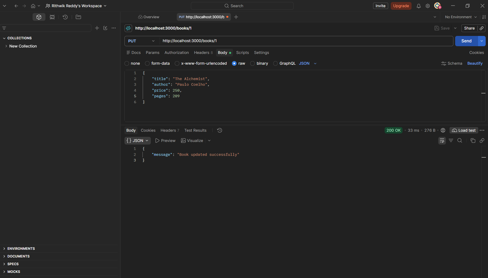
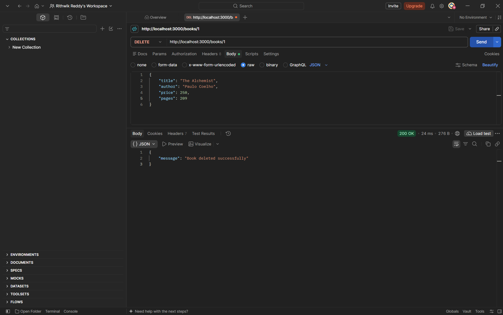
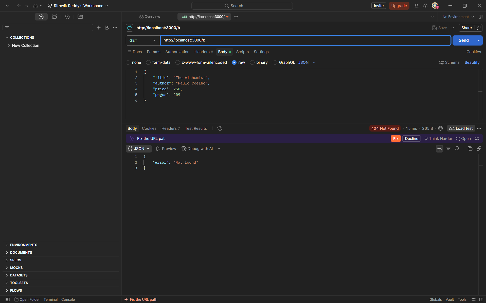
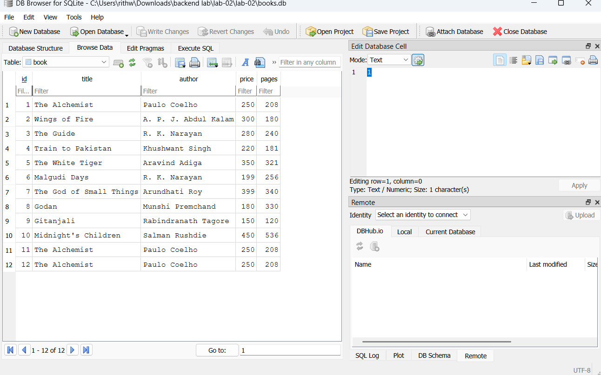

# Lab 2: SQLite database and CRUD routes

**Name:** Your Name · **Registration number:** Your Reg No · **Section:** Your Section

**Live link:** Not deployed yet (paste your public URL here, or explain why it could not be deployed and add Postman screenshots of every endpoint)

## How to run

```bash
npm install
npm run dev     # nodemon: restarts on every change
npm start       # plain node
```

Environment variables: none required. Optionally set `PORT` (default 3000). Do not commit a `.env` file.

The database file `books.db` is included. To rebuild it from scratch:

```bash
rm books.db
sqlite3 books.db < schema.sql
```

## Endpoints

| Method | Path | Description | Success status |
| --- | --- | --- | --- |
| GET | `/books/` | Return all books | 200 |
| GET | `/books/:bookId/` | Return one book (404 if missing) | 200 |
| POST | `/books/` | Add a book from a JSON body | 201 |
| PUT | `/books/:bookId/` | Update all fields of a book | 200 |
| DELETE | `/books/:bookId/` | Delete a book | 200 |

Errors: 400 for invalid id or body, 404 for a missing book, 500 for server errors.

Example body for POST and PUT:

```json
{ "title": "Gitanjali", "author": "Rabindranath Tagore", "price": 150, "pages": 120 }
```

## Screenshots









## Viva answers

- **Why await the database call?** Database calls are asynchronous and return Promises. Without `await` the code continues before the result exists, so you would get a pending Promise instead of rows.
- **SQL injection and placeholders:** SQL injection is when user input is joined into the SQL string and changes the query (e.g. `1 OR 1=1`). With `?` placeholders the SQL and the values are sent separately, so input is always treated as data and never as SQL.
- **PUT vs POST:** POST creates a new resource and the server picks the id. PUT updates (replaces) an existing resource at a known URL such as `/books/3/`, and repeating it gives the same result.

## Notes

Problems faced and how you solved them: (write your own notes here)
